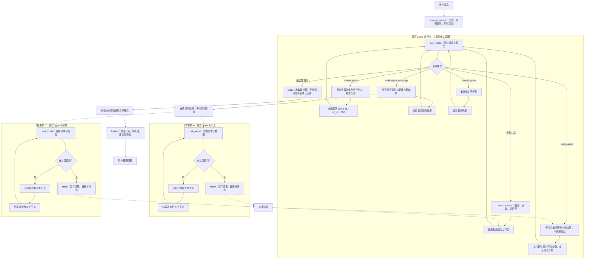

Status: ready-for-agent

Implementation: complete（2026-10-26；Docker 完整 Python 回归 300 通过、5 跳过，主从只读会话浏览器专项通过）

# 对话主智能体与子智能体编排

## 目标与已确认范围

主智能体自主决定是否分工，通过异步工具创建多个子智能体，等待结果、补充任务或取消任务，最后统一回答用户。用户无需开启多智能体模式。模型先做轻量拆分判断：存在至少两个相互独立、可并行完成并统一汇总的调查、比较、核验或审查分支时，默认创建 2～3 个子智能体；简单问题、强依赖流程和共享状态操作由主智能体直接完成。用户明确要求并行或委派时优先执行。普通问题保留直接回答路径，不增加关键词路由或每次必经的独立规划模型调用。

术语见 [GLOSSARY](../../GLOSSARY.md)，决策见 [ADR 0017](../../docs/adr/0017-main-and-subagent-orchestration.md)。主从默认共用当前文字模型配置，通过不同身份、系统提示、独立上下文与工具权限形成不同智能体；每个 `call_model` 都发出一次真实模型请求。

首版仅两层，子智能体不能创建下一级，也不彼此直接通信。子智能体在当前回答尝试内可继续接受任务，不跨用户消息或回答重试复活。首版只允许向空闲或已完成的子智能体追加任务；执行中追加返回结构化冲突，不隐式中断、不插入并发上下文。

## 完整执行图

实线为当前循环内的执行，虚线为后台提交或结果通知。创建工具不等待子任务完成；子任务只运行自己的工具图。

队列按任务所属智能体调度，一条任务只交给一个子智能体；图中 A、B 表示不同任务可并行。根图仍是 `prepare_context → agent → finalize`；调度器不是必须独立建成 LangGraph 节点。一个模型回复可以包含多个工具调用，创建调用依次返回 ID 即可让多个后台任务并行。单个智能体的上下文始终串行更新。

## 四个编排工具的合同

所有参数使用严格对象校验；账号、会话、回答尝试、父智能体、操作身份和模型配置由后端绑定，不接受模型指定。所有 ID 必须属于当前账号与回答尝试。工具失败作为结构化结果回传，不能因此绕过限额或静默创建替代任务。

### spawn_agent

参数：`title`（1–80 字符）、`task`（1–12000）、`context`（可选，最多 16000）、`expected_output`（1–4000）、`instructions`（可选，最多 4000）。`instructions` 由主智能体提供，只细化任务方法、重点和交付方式，追加在后端固定的子智能体规则之后，不能覆盖安全规则或工具权限。

返回 `agent_id`、`run_id`、`status: queued`。在同一事务中验证根回答有效、预留创建额度、创建记录；提交后再调度。调度失败保存失败状态。幂等身份由后端绑定 `parent_run_id + model_round + tool_call_id`；重复执行同一调用返回原 ID，不重复占额度。内容相同但调用身份不同不自动合并。

创建成功后主模型带着工具结果继续执行，可自行使用业务工具、再创建子任务或等待，不自动等待子任务。

### wait_agents

参数为严格空对象 `{}`，不接受 `agent_ids`、游标或单次等待时长；账号、回答及接收范围全部由后端绑定。

主动等待和被动交付共用当前回答尝试的结果信箱。子执行完成、失败、取消或超时，须与终态原子登记一次事件；结果和来源来自真实执行记录，不从模型文字构造。主智能体每次模型请求前自动收取未交付事件；先补齐同批工具回复，再追加被动资料消息。事件按登记顺序批量交付，以 run 区分首次与补充任务，不能只查询每个 agent 的最新执行。

调用 wait 时已有未读事件立即返回 `status: results`、`agents`（含 agent_id、run_id、status、result、error、sources）和交付身份；无事件但仍有排队／运行任务则挂起主执行线程，不占子任务工作池、不额外请求模型；无事件且无活动任务立即返回 `status: idle`。根停止、资料撤销或截止时间到达终止等待。等待不进入普通工具的失败重试计数，数据库等执行故障终止本次执行，不让模型无限重试。

保存结果后先提交事务再唤醒。Condition 与通知版本号共同防止查库与睡眠之间错过通知；同锁比较版本及进入等待，数据库操作不持 Condition 锁。定期后端检查仅用于停止／截止时间与漏通知兜底，不消耗模型轮次。

同一 run 的终态事件唯一；主动与被动交付共享持久化交付批次，同一调用重放返回原批次，每次仍重新鉴权。批次正文与已交付标记同事务保存；当前图 State 也记录已应用批次，避免重复追加。资料撤销清理信箱事件、交付正文与旧缓存；不能仅删除来源而保留依赖正文。交付受上下文预算约束，无法容纳时明确失败，不静默截断。已交付来源才进入最终核验。

主模型无工具调用的输出先作为候选回答。收尾检查有未读事件时交付并继续模型；仍有活动任务时后端等待，模型可预先 cancel_agent 放弃不需要的任务；无事件且无活动任务才在根锁内关闭分派并确认回答。模型生成期间到达的结果不会中断该次请求。下一模型轮次开始时重置当前草稿，沿用 SSE 整条快照替换，避免重生成答案拼接；无需新增前端事件协议。实际模型请求仍受原轮次、预算和总时限限制。重启仍终止旧尝试，不增加图断点恢复。

### send_agent_message

参数：`agent_id`、`message`（1–12000 字符）、`instructions`（可选，最多 4000 字符，省略时沿用上一轮）。仅允许当前回答内最近一次执行已完成的子智能体继续工作；失败、取消、超时或已关闭的智能体不自动复活，需要主智能体重新创建。

保留该子智能体的已有任务、消息和工具结果，新建带独立操作身份的执行轮次；同一智能体最多一个 queued/running 执行，由事务与数据库约束保证。返回 `agent_id`、新 `run_id`、`status: queued`。运行中返回 `agent_busy`，不排入收件箱。最多三个执行轮次，包括首次任务；补充调用同样按主调用身份幂等。后续通过自动收信或 wait_agents 获取新结果。

### cancel_agent

参数：`agent_id`。排队或运行任务变为 cancelled，阻止继续外发和写入正文；已结束任务返回原终态，不重写为取消。重复取消幂等。工具返回取消后的状态，不把未结束请求描述为已撤销计费。

## 上下文与业务工具

- 子智能体输入为后端固定系统规则、主智能体任务级 `instructions`、明确任务、必要背景、预期交付及有效资料说明，不默认复制全部会话，也不共享可变消息列表。角色提示只在模型请求时注入，不写入子智能体历史；读取旧执行时过滤历史 system 消息。补充任务延续同一子智能体上下文；超上下文预算明确失败，不静默截断或引入本期未约定的摘要器。
- 工具按公共、主智能体专属和编排三组注册。主智能体使用公共工具、记忆工具和四个编排工具；子智能体复用同一套安全公共工具（时间、附件检索／读取、会话绑定知识库检索、网页搜索／抓取），不使用减法自动继承记忆或编排权限。第一版不向子智能体开放记忆查询、变更工具；主智能体可按需传递相关背景，且继续遵守资料外发规则。
- 子智能体不运行自动记忆，不进入用户 messages 表，不把结论当作用户事实写入 Mem0。只由主智能体写用户回答。
- 工具权限在定义暴露与后端执行两处校验。附件归属、有效期、来源删除、知识库会话绑定在执行时验证；不允许模型指定更广范围。读取与交付之间撤销权限时，失效内容不得继续传给主智能体。
- 子任务结果明确区分结论、证据、未解决事项；其文本仍是待主智能体验收的资料，不能覆盖系统规则或给自己扩大权限。不展示或要求保存私有推理过程。

## 身份、持久化与代码落点

采用 `agents`（身份）、`agent_runs`（执行轮次）、`agent_messages`（模型与工具消息）保存执行；`agent_inbox_events` 保存按子 run 唯一的终态事件，`agent_inbox_deliveries` 按主 run 与后端交付 key 保存幂等批次。agent 关联根助手消息、账号／会话、父 agent 与角色；run 记录序号、独立 operation、幂等请求键、任务、状态、结果、错误和时间；消息按 agent/run 与序号唯一。凭据、客户端和连接不进入 State 或持久化消息。

子任务执行状态：`queued → running → completed / failed / cancelled / timed_out`；queued 可直接取消或失败，终态不可被迟到成功覆盖。同一子智能体最多一个活动执行。稳定 agent 身份与 run 分离，追加任务新建 run；子智能体 `finish` 仅完成本次任务，不结束根回答。

`model_calls` 增加 agent/run 关联，保留根 `assistant_message_id`；调用分别统计并可按回答汇总。子执行独立 operation，关联根 operation，不能直接复用只允许用户消息原 operation 的 guard。所有外发前核验根回答与子执行有效性。

现有 `MemoryCheckpoint`、`memory_tool_runs` 和用户消息级结果不得供多个子执行共享。通用 agent 运行记录按 run 分区，缓存键至少含 run、阶段、模型轮次与调用身份。联网搜索状态不能由主从共用一个 operation，避免一个任务结束影响其他任务；不把模型参数当幂等身份。旧记忆副作用幂等合同保留。

建议模块：`agent/orchestration.py` 统一创建／等待／追加／取消，`agent/runner.py` 执行独立工具图，`agent/repository.py` 管记录，`agent/tools.py` 管工具与权限，`agent/sources.py` 管证据交付。模块名可按代码整合，接口和验收合同不可省略。

## 来源交付与最终核验

建立回答尝试级来源登记，保存真实工具结果与来源身份／版本、发现它的 agent/run。已有 W/K 编号使用后端分配的唯一身份，不接受模型自造的来源对象。信箱主动与被动交付的来源清单由后端根据真实工具记录构造，不从子智能体结论中反解析后信任。

主智能体允许引用自己真实取得的来源，以及经结果信箱主动或被动交付的子任务来源。后台已搜索但尚未交付的来源不自动加入允许清单。最终仅持久化正文实际引用的有效来源；未知编号继续显示未核验提示。保留 `[K编号]` 与 `[[MEDIA:K编号]]` 协议、类型校验、受保护原图及表格展示。

停止、删除、到期、知识库取消绑定后重新验证来源；撤销来源不能通过缓存、追加任务或旧交付批次重新进入主上下文。图片、来源摘录及正文仍遵守原清理规则，新增记录必须纳入既有来源清理链路。

## 调度、预算与生命周期

- 单应用进程使用有界线程池和有界队列，数据库先提交、再提交任务。单回答并发最多 3、创建最多 6，每子智能体最多 3 次执行；主智能体不占子任务池。队列满返回明确的资源不足，不无界积累。
- 应用子任务总并发默认 6，账号子任务并发默认 3；同账号多会话也受共同限制。公平调度避免一个无空闲配额的账号堵住其他账号。排队与等待时间均计入总时限。
- 主智能体最多 24 次模型调用，每个子执行最多 12 次。根回答最多 96 次 agent 模型调用、24 次网页搜索／抓取，最长 600 秒；单子执行最长 180 秒。参数集中配置，根预算在外发前原子预留，失败的真实调用仍计数；实际 usage 按服务商返回记录。不声称这些限制是精确金额或 token 额度，首版不增加严格总 token 配额。
- 工具自己的次数及重试上限在各执行内保留，且不能绕过根预算。轮次耗尽返回明确失败；不因等待超时自动无限增加主模型轮次。
- 联网失败按 HTTP 分类：不可重试请求及后端重试耗尽的相同参数，在当前执行内返回缓存失败，不再次外发；不同 URL／查询仍独立执行。401／402 禁用当前执行的搜索与抓取。408／429／5xx 及连接超时由后端最多尝试三次，指数退避加抖动并尊重 Retry-After，超过 10 秒等待要求则结束本次请求。每次真实重试仍独立记录和扣根预算，退避等待中检查取消及配置版本，重试前重新核验生命周期。结构化失败带安全说明、状态、代码、请求 ID 和次数，不携带上游原始正文；不再叠加普通工具的模型重试计数。
- 用户停止、根执行失败、主智能体完成最终回答、会话删除都关闭后续分派，取消所有活动子任务并唤醒等待。终态检查覆盖提交、外发、结果写入、交付和最终持久化。已发请求可以接收用量，不能恢复结果；不靠取消 Python future 保证业务取消。
- 超时计时器或监控负责在截止时设置终态并唤醒等待；阻塞网络线程受已有网络超时约束。停机时先取消与唤醒，再有界等待线程，不能无限 join。启动标记未完成执行为中断失败，不自动重发请求。
- 重试生成新回答尝试，不复活旧 agent。删除会话清理 agent 消息、任务和证据正文；历史调用仍按项目原有保留规则处理外键。

## 子智能体只读会话

子智能体拥有稳定的 `agent_id` 和可查看的聊天线程，但用户不能直接向子智能体发送消息。主智能体派工、补充任务和取消继续通过编排工具完成；用户只负责查看、审计和打开来源。

聊天线程属于根回答尝试而不是独立用户会话。每次 `agent_run` 作为一次执行轮次展示：主智能体派工文本作为主智能体消息，执行结果作为子智能体消息，失败、取消和超时作为系统状态。工具活动和内部模型消息不拼接为聊天正文，私有推理不返回。

新增授权只读接口按账号、会话、回答和子智能体身份读取完整公开线程：返回标题、最新状态和按 sequence 升序的执行轮次，每轮包含任务、状态、结果、错误、时间和实际来源。来源撤销或回答失效后沿用既有清理规则，不再返回旧正文。

前端在回答下显示子智能体列表，点击后在侧栏或对话框打开只读聊天。主 Agent 派发后只显示任务与状态；子 Agent 运行期间不显示回复或来源。只有 run 终态事件已正式交付主 Agent 后，才一次性显示子 Agent 最终回复及来源，来源必须位于该回复气泡内部并按规范 URL 去重，空标题不得回退为内部 W 编号。界面不提供输入框、发送按钮或单独取消入口；用户仍可停止整个回答。子智能体完成后，主对话显示带发送者身份的回复卡，主智能体继续追加任务时在同一子线程按新的执行轮次展示。

## 用户界面与传输

沿用现有消息 SSE 快照，在回答中增加 `agent_tasks` 简要列表：标题、agent/run ID、状态、简短结果或错误。默认折叠，展开显示任务、交付结果和可访问来源。详情经当前账号／会话授权按需加载，不在每个文字分片传送完整工作历史。

主回答之外不混入子智能体正文；子智能体拥有只读聊天线程，不展示推理内容或允许直接输入。刷新与断线重连从持久化记录恢复，切换会话关闭订阅但不取消任务。用户“停止生成”取消整个回答及全部子任务；首版不增加用户直接分派子任务入口。主从用量可在现有记录中辨认与汇总。

## 已确认测试接口与审查范围

2026-10-23 用户确认：

1. 四个编排工具公开接口：覆盖创建、并发等待、追加、取消、身份和幂等、预算与错误；不据此验证真实模型质量。
2. 聊天 HTTP/SSE 到受控模型 HTTP：覆盖模型真实调用顺序、权限、引用、停止与界面状态；不据此声明真实外部服务兼容或可用。

遵循 TDD 逐条纵向实现，定期类型检查和单文件测试，最后运行全套测试。按公开接口观察结果，不以私有方法或数据库旁路替代用户行为断言。新增／修改函数及回调均提供中文用途注释。

2026-10-23 初版审查基点为 `eb91a77582b0cc6f4227e5138808a85e4ab76599`；2026-10-26 信箱增量审查基点由用户确认为 `d6b73610a9bc5c9e610f4b08c9d3678ab5f591a8`，测试继续沿用上述两处接口。只审查对应功能增量。文档写入不代表实现或验收完成，交付前补充实际验证记录及未验证边界。

## 实现任务

1. [身份、持久化与隔离](issues/01-execution-records.md)
2. [四工具与有界调度](issues/02-orchestration-tools.md)
3. [模型循环、上下文与权限](issues/03-agent-runtime.md)
4. [来源交付与最终引用](issues/04-source-delivery.md)
5. [停止、预算、超时和清理](issues/05-lifecycle.md)
6. [界面、完整回归与交付](issues/06-ui-and-verification.md)
7. [主动等待与被动结果信箱](issues/07-result-inbox.md)
8. [子智能体只读会话界面](issues/08-read-only-agent-chat.md)

## Comments

- 2026-10-23：用户确认主智能体自主分工；理解创建后继续调用主模型、等待、追加与取消的工作方式，要求先改文档再改代码。当前为规格与任务阶段，代码未实施。
- 2026-10-23：身份记录、四工具、有界调度、来源交付、生命周期、SSE 任务快照与按需详情均已实现。Python 回归、类型检查、生产构建与 22 项浏览器测试通过；真实模型是否稳定选择分工属于待验边界。证据见[验证记录](../../docs/verification-multi-agent.md)。

- 2026-10-26：用户要求先更新文档再实现主动等待与被动通知；沿用两个已确认测试接口，本次审查基点 d6b73610a9bc5c9e610f4b08c9d3678ab5f591a8。
