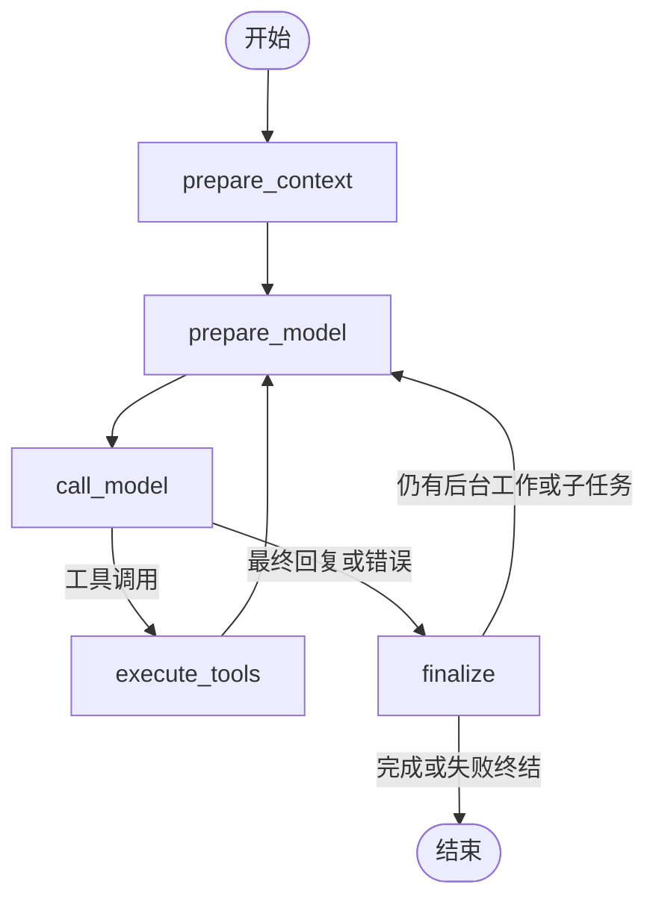

# Agent State

主智能体和子智能体使用同一个 `AgentState` 和同一套五节点图。State 是可检查的动态工作数据；固定身份、配置、客户端与回调分别属于 `AgentContext` 和节点依赖。

AgentStateUpdate 只是节点增量返回值的类型约束，不是第二套图状态。

| 字段 | 含义与用途 |
| --- | --- |
| `version` | 唯一 State 的结构版本；恢复前验证，拒绝解释其他结构的检查点。与图的数量无关。 |
| `run_id` | 当前执行标识；核对检查点归属，防止新回答首次写入前中断后误续接上一轮。 |
| `messages` | 模型工作消息，包含对话、摘要、当前工具调用及结果。模型节点追加消息，准备节点压缩消息，收尾节点提交最终正文。稳定消息 ID 用于重放去重；私有推理在检查点序列化时移除。 |
| `model_round` | 已完成的模型回合数；控制调用上限及步骤幂等身份，新回答归零。 |
| `loaded_skills` | 已加载 Skill 的 `name/version/root/entry`；可直接看到允许访问的 Skill 路径。加载 Skill 更新清单，读取 Skill 文件与构造系统提示使用它。工具注册不依赖它。 |
| `attachments` | 当前会话有效附件的 `id/filename/kind`；类型为 document、image 或 source。文档工具按可读取文档开放，图片单独进入视觉消息，原始制作资料可导入工作区。实际读取仍核对账号、会话及有效期。 |
| `knowledge_bases` | 当前会话选定的知识库 `id/name`；决定知识库工具是否可用。实际检索重新核验绑定和归属。 |
| `pending_agent_run_ids` | 仍在排队或运行的子任务；工具执行与信箱交付后刷新。已完成但未交付的结果仍从持久化信箱收取。 |
| `tool_failure_counts` | 本次 Run 各普通及 Skill 工具的累计失败次数；失败次数超限后隐藏工具并拒绝伪造调用。网页工具还遵守后端重试及服务商级禁用规则。 |
| `document_call_counts` | 文档及知识库工具各自的调用次数，失败和无效参数也计数；限制单次回答的读取次数。 |
| `finished` | 收尾是否完成；尚有后台工作或未读子任务时继续循环。 |
| `error` | 导致本次回答终止的错误；工具可恢复错误保留在工具消息中，不直接终止回答。 |

回答正文来自 `messages` 的当前助手消息；工具是否调用可直接检查消息，不重复保存 `answer` 或 `used_tools`。外部操作和业务助手消息仍有各自的数据库身份，但不重复塞入 State。生成文件、来源、命令日志和工具幂等结果各由业务表保存。

新回答重置本轮计数并保留已有对话及摘要，移除上一轮原始工具轨迹，再刷新材料和访问清单；继续执行从原检查点接着运行，保持原轮次、额度和工作消息。Skill 文件授权与会话工作区权限是两件事：只有读取 Skill 根目录要求先加载，工作区工具直接校验允许访问的路径。
